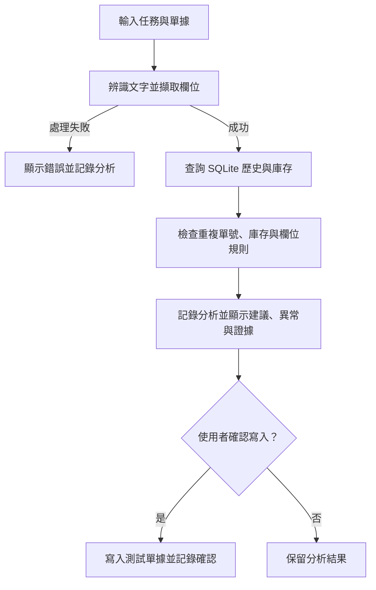

# 智慧電動單據出貨與庫存異常決策代理人

**Smart Warehouse AI Agent: Document Understanding and Inventory Anomaly Decision Agent**

原型讀取入出庫單據的圖片或 PDF，擷取品項與數量，檢查重複單號、缺欄與可用庫存不足等異常，再把判定依據交給人員覆核。

本儲存庫收錄論文初稿。可執行程式、範例與測試位於[原型儲存庫（版本 `78c5dfa`）](https://github.com/john19991225-commits/-/tree/78c5dfa897fb4e70abf9a3812d461239025c72ef)。

## 功能與目前進度

| 狀態 | 功能 |
| --- | --- |
| 已實作 | 透過 Tesseract 辨識圖片，或擷取 PDF 內嵌文字，解析單號、日期、倉別、棧板類型、SKU、數量與單位。 |
| 已實作 | 查詢 SQLite 歷史與庫存，檢查重複單號、缺少必要欄位、查無品項、不合規的數量或單位，以及出貨量超過可用庫存。 |
| 已實作 | 介面顯示欄位、異常與證據。經人工確認後寫入本機測試單據，並留下稽核紀錄。 |
| 規劃中 | 掃描版 PDF 處理、模糊查重、庫存快照時效檢查、辨識信心校準，以及依中間結果調整工具的規劃流程。 |



## 快速開始

以下 PowerShell 指令適用於原型儲存庫，需安裝 Git 與 Python 3.11。Streamlit 首次啟動會建立本機 SQLite 測試庫並載入合成庫存。

```powershell
git clone https://github.com/john19991225-commits/-.git warehouse-agent
cd warehouse-agent
git checkout 78c5dfa897fb4e70abf9a3812d461239025c72ef
py -3.11 -m venv .venv
.\.venv\Scripts\Activate.ps1
python -m pip install -r requirements.txt
Copy-Item .env.example .env
python -m unittest discover -s tests -v
streamlit run app.py
```

預設 `OCR_PROVIDER=auto`。圖片辨識需另裝 Tesseract 及對應語言資料，PDF 需具備可擷取的文字層。使用合成示範時可略過 Tesseract。

### 跑一次合成單據示範

在原型目錄開啟 PowerShell。以下指令從隨附範例擷取表頭與第一筆品項，透過合成文字提供者示範單筆品項流程。`.png` 副檔名用來通過上傳介面的檔案類型限制，檔案內容仍是合成文字。

```powershell
$env:OCR_PROVIDER = 'synthetic'
$env:DATABASE_PATH = 'data/demo-warehouse.db'
[IO.File]::WriteAllLines((Join-Path (Get-Location).Path 'demo-receipt.png'), [string[]](Get-Content -Encoding UTF8 data/synthetic_receipt.txt -TotalCount 5), [Text.UTF8Encoding]::new($false))
streamlit run app.py
```

1. 保留預設任務，首頁上傳 `demo-receipt.png` 後按「開始分析」。
2. 在新的示範資料庫中，確認解析到 `SYN-2026-0001` 和 `WH-A`，狀態為 `PASS_RECOMMENDED`。
3. 檢視欄位與證據，輸入確認者代號並勾選確認，再按「確認並寫入測試資料庫」。
4. 再次分析同一檔案，可看到重複單據異常。測試資料庫會阻擋第二次寫入同一單號。

## 驗證與實驗

專案記錄的 **6/6** 指六項原型自動化測試全部通過，涵蓋確認後才寫入與留下稽核記錄、重複單據及寫入阻擋、缺欄補正、空檔處理、無效圖片錯誤回報及庫存不足。這組測試用於確認程式行為。

| 方法 | 正式比較 |
| --- | --- |
| B0 人工輸入與核對 | 待驗證，尚未執行 |
| B1 OCR 加固定規則 | 待驗證，尚未執行 |
| B2 OCR 加決策代理人 | 待驗證，尚未執行 |

## 專案文件

| 文件 | 位置 |
| --- | --- |
| 英文論文初稿 | [LaTeX 原始稿](./smart-warehouse-ai-agent-paper.tex) · [論文 PDF](./smart-warehouse-ai-agent-paper.pdf) |
| 原型說明 | [README](https://github.com/john19991225-commits/-/blob/78c5dfa897fb4e70abf9a3812d461239025c72ef/README.md) · [程式入口](https://github.com/john19991225-commits/-/blob/78c5dfa897fb4e70abf9a3812d461239025c72ef/app.py) · [自動化測試](https://github.com/john19991225-commits/-/blob/78c5dfa897fb4e70abf9a3812d461239025c72ef/tests/test_mvp.py) |
| 專案提案 | [proposal.md](https://github.com/john19991225-commits/-/blob/78c5dfa897fb4e70abf9a3812d461239025c72ef/proposal.md) |
| 系統架構 | [architecture.md](https://github.com/john19991225-commits/-/blob/78c5dfa897fb4e70abf9a3812d461239025c72ef/architecture.md) |
| 演算法 | [algorithm.md](https://github.com/john19991225-commits/-/blob/78c5dfa897fb4e70abf9a3812d461239025c72ef/algorithm.md) |
| 實驗規劃 | [experiments.md](https://github.com/john19991225-commits/-/blob/78c5dfa897fb4e70abf9a3812d461239025c72ef/experiments.md) |
| OpenSpec 規格 | [單據輸入與欄位擷取](./openspec/specs/document-intake/spec.md) · [庫存異常判定](./openspec/specs/inventory-anomaly-review/spec.md) · [人工確認與稽核](./openspec/specs/human-confirmation/spec.md) |
